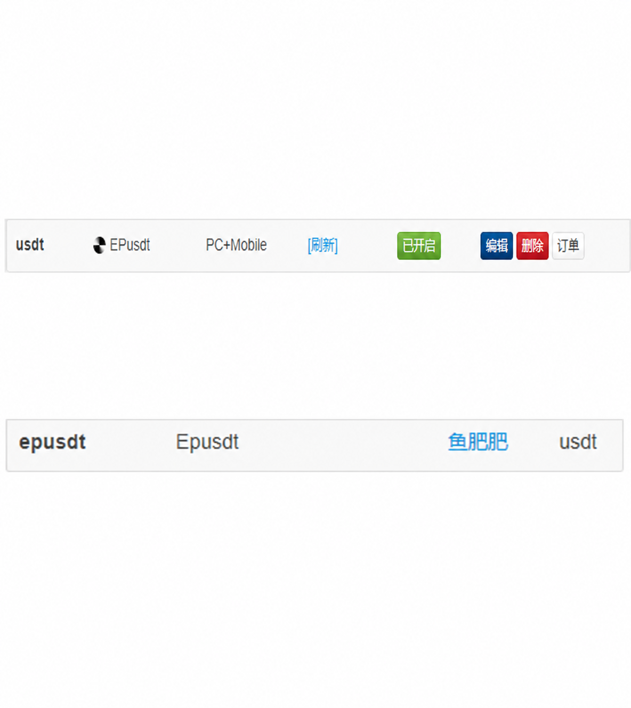
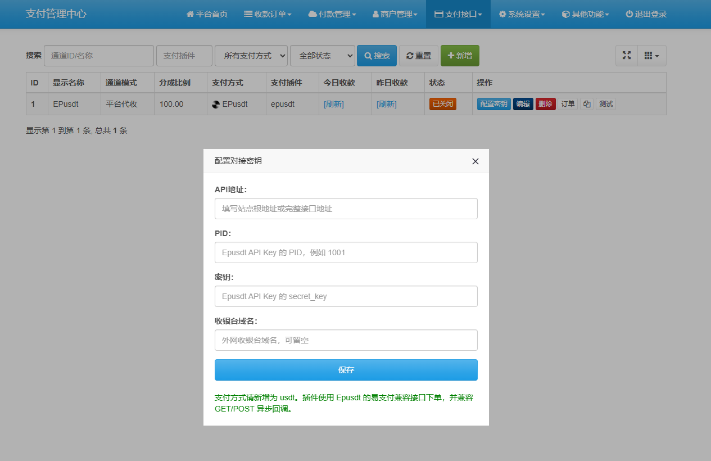

<div align="center">
  
</div>

<div align="center">
  
  
  <a href="https://github.com/Yufeifeio/Epay">
    
  </a>
  <a href="https://t.me/pyufc">
    
  </a>
</div>

# Epay-epusdt

 鱼肥肥 [@pyufc](https://t.me/pyufc) 此款插件是基于 [Epay](https://github.com/Yufeifeio/Epay) 开发，其它版本易支付不保证100%可用！

<p align="center">
  
</p>

Epusdt 对接易支付插件，使用官方 EPay 兼容接口，当前对照 [Epusdt v2.1.3](https://github.com/GMWalletApp/epusdt/releases/tag/v2.1.3) 核对。

## 安装

1. 将 `plugins/epusdt/epusdt_plugin.php` 放入易支付对应插件目录。
2. 将 `assets/icon/usdt.ico` 放入易支付支付方式图标目录。
3. 在后台新增支付方式 `usdt`。
4. 在支付通道中配置以下字段。

| 字段 | 说明 | 示例 / 默认值 |
| --- | --- | --- |
| `appurl` | Epusdt 根地址或完整 EPay 接口地址，不带查询参数或锚点 | `https://pay.example.com/` |
| `appid` | Epusdt API Key 的数字 PID | `1001` |
| `appkey` | 同一 API Key 的 `secret_key` | 必填 |
| `appswitch` | 公网收银台地址；留空使用接口地址对应的收银台域名 | `https://pay.example.com/` |
| `appselector` | 网关已启用且可收款的 `token.network`，或 `alipay` | 留空为 `usdt.tron` |
| `appcurrency` | 易支付订单的计价法币，随下单请求参与签名 | 留空为 `cny`，可填 `usd` 等 |

PHP 需要 `curl` 扩展和有效的 CA 证书库。生产环境建议使用 HTTPS；插件会校验服务端证书。若 API 使用 `127.0.0.1` 等内网地址，必须填写买家可以访问的公网收银台地址。`appurl` 推荐填写网关根地址；填写完整接口时应使用 `/payments/epay/v1/order/create-transaction/submit.php`。根目录的 `/submit.php`、`/mapi.php` 只有在服务器另行配置兼容转发时才可用。

## 适用范围

| 项目 | 已验证范围 / 要求 |
| --- | --- |
| 易支付 | 基于本页所链接的 `Yufeifeio/Epay` 插件接口，必须提供 `lib\Payment::lockPayData`、`processNotify` 及相同的订单字段 |
| 网关 | 官方 Epusdt v2.1.3 EPay 兼容接口 |
| PHP | PHP 7.4、8.0、8.2 的回归测试通过；其他版本需在对应环境验证 |
| 默认配置 | `usdt.tron` + `cny`，网关须启用 TRON-USDT 并配置有效收款地址 |
| 其他资产 | 使用网关支持且已启用的 selector，并配置该网络的有效收款地址及汇率 |
| 回调与域名 | 易支付回调域名必须公网可访问，HTTPS 证书有效，不能被登录验证或 WAF 拦截 |

其他易支付分支需先核对插件接口，不能仅凭名称相同判断兼容。订单法币必须与实际计价一致；美元计价的用户应填写 `usd`。

## 说明

- 当前适配目标为 Epusdt v2.1.3，使用 `/payments/epay/v1/order/create-transaction/submit.php`，成功时读取 HTTP 302 的 `Location`。
- EPay 的下单和回调仍使用 **MD5**。GMPay v2 的 HMAC-SHA256 属于另一套协议，不能替换到本插件中。
- 默认提交 `type=usdt.tron&currency=cny`。`appselector` 可指定 `usdc.base` 等已启用资产，网关必须同时具备对应收款能力。
- `appselector=alipay` 使用网关默认资产；网关的 `epay.default_token` 和 `epay.default_network` 均为空时，创建等待选择资产的收银台订单。这里的 `alipay` 是官方兼容接口参数，不代表本插件直接接入支付宝。
- 回调支持 `GET` / `POST`，校验签名、数字 PID、订单号、网关流水号、成功状态和金额。兼容官方 `100.2000` 这类四位小数金额，不通过浮点四舍五入放宽金额校验。
- `notify_url` 必须公网可访问。同步返回页只展示订单状态，到账以验签成功的异步通知为准。
- 保留易支付 `lockPayData` 的已缓存付款链接。网关仅允许相同签名字段重新打开原待支付订单；字段改变、过期或旧订单缺少首次请求记录会返回 `10002`，应新建订单。
- 本轮未重新运行旧版 Epusdt 网关；旧版本部署请先核对是否支持 `currency` 和上述接口。

升级步骤、配置注意事项和变更明细见 [v2.1.3 升级说明](docs/UPGRADE-v2.1.3.md)。接口依据：[官方 API 文档](https://github.com/GMWalletApp/epusdt/blob/v2.1.3/wiki/API.md#epay-兼容创建交易)。

## 回归检查

在项目根目录执行：

```sh
php -l plugins/epusdt/epusdt_plugin.php
php tests/run.php
```

测试要求 PHP 7.4+、`curl` / `openssl` 扩展、`openssl` 命令和可用的 `proc_open`。测试使用本机临时 HTTP / TLS 服务，不连接真实网关，不调用真实商户的到账处理。覆盖官方签名样例、下单参数、支付资产与法币、地址解析、有限的 GET 兼容重试、回调校验和不受信任的 HTTPS 证书。

另有 [官方网关联调测试](tests/integration/README.md)，在官方 v2.1.3 的临时数据库中，直接调用本插件并接收官方代码生成的签名通知，覆盖默认资产、完整接口地址、USD、`alipay` 两种模式及 Solana。

## 相关截图

<p align="center">
  
  
</p>
